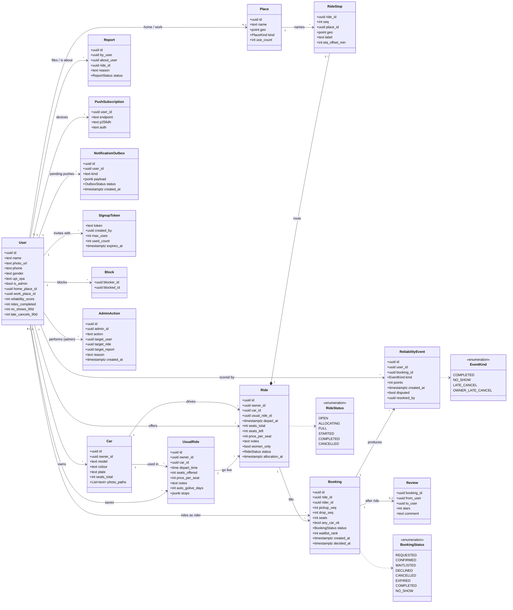

# Database class diagram

The whole data model from [lld.md](lld.md) as one picture. Classes are singular (`User`); the
actual tables are plural (`users`). Arrows read left to right: `User "1" --> "*" Car` means one
user owns many cars.

## What the picture can't show

Rules that live in the schema but not in boxes and arrows:

| Rule | Where | Why |
|---|---|---|
| `UNIQUE(usual_ride_id, depart_at)` | Ride | Auto go-live run twice still creates one ride per day |
| `UNIQUE(ride_id, rider_id)` where status in REQUESTED / CONFIRMED / WAITLISTED | Booking | One active booking per rider per ride |
| `PRIMARY KEY(ride_id, seq)` | RideStop | Stops are ordered; `d.seq > p.seq` in search needs this |
| `seats_left >= 0`, changed only by the conditional UPDATE | Ride | The last-seat guarantee ([lld.md §2](lld.md#2-the-last-seat)) |
| `pickup_seq < drop_seq` check | Booking | You can't ride backwards |
| GiST index on `geo` | RideStop, Place | Makes the 2 km proximity search fast |
| Score columns on User are a cached rollup of ReliabilityEvent | User | The events are the truth; the daily job recomputes ([lld.md §3](lld.md#3-reliability-score)) |
| Row-Level Security: phone / plate / photos readable only within a confirmed booking | User, Car | Privacy by default (D12) |

## How to read it against the flows

- **One-time setup** writes `User`, `Car`, `UsualRide` — and never again (D7).
- **The evening tap** copies `UsualRide` into `Ride` + `RideStop` rows (F-B2).
- **Booking life** is one `Booking` row changing status, with every change to seats going
  through `Ride.seats_left` in the same transaction (F-D5).
- **The score** is append-only `ReliabilityEvent` rows; nothing ever edits history, disputes
  just mark an event void (F-F3 to F-F5).
- **`NotificationOutbox`** is written in the same transaction as the change it announces, then
  drained by the push sender — so a crash can't lose a "you're confirmed" (lld.md §6).
